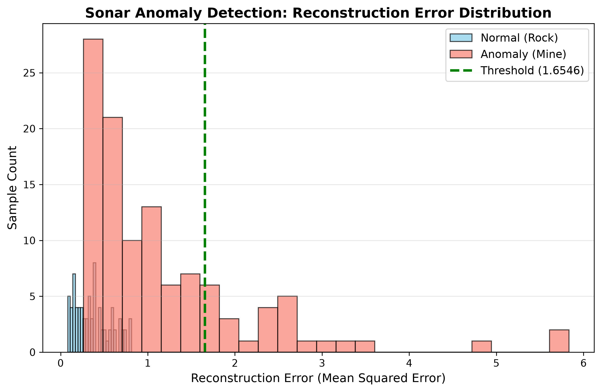

# 🌊 Deep Learning Acoustic Sonar Anomaly Detection

An **unsupervised deep learning pipeline** built with PyTorch to detect hidden underwater hazards (such as naval mines) from active sonar signal returns. Instead of relying on scarce labeled anomaly data, this project implements a **Deep Autoencoder** trained exclusively on normal seabed profiles to flag unfamiliar objects via reconstruction error distribution.

---

## 🚀 Project Overview
In real-world marine defense and underwater exploration, training a standard supervised classifier is challenging because hazardous anomalies (like unexploded ordnance or submerged debris) are extremely rare and rarely pre-labeled. 

This project solves that problem using a **semi-supervised anomaly detection** approach:
1. **Normal Training:** The autoencoder is trained *only* on normal seabed acoustic returns (rocks). It learns the compressed latent representation of standard seabed echoes.
2. **Anomaly Inference:** When the model encounters an unfamiliar object (a mine), it fails to reconstruct it accurately, producing a significantly higher **Mean Squared Error (MSE)** reconstruction loss.
3. **Dynamic Thresholding:** A statistical threshold is established using the 95th percentile of validation errors to automatically separate normal echoes from hazardous anomalies.

---

## 🏗️ Model Architecture
The architecture consists of a symmetric Multi-Layer Perceptron (MLP) autoencoder designed to compress and reconstruct 60-dimensional frequency energy bins:
* **Encoder:** $60 \rightarrow 32 \rightarrow 16 \rightarrow 8$ (Bottleneck Layer)
* **Decoder:** $8 \rightarrow 16 \rightarrow 32 \rightarrow 60$
* **Loss Function:** Mean Squared Error (MSE)
* **Optimizer:** Adam ($\text{lr} = 0.001$)

---

## 📊 Results & Visualization
The model successfully isolates acoustic anomalies by measuring reconstruction deviations. Below is the distribution plot comparing normal rock signals against anomalous mine signals:

* **Blue Distribution (Normal/Rocks):** Low reconstruction error because the network learned this exact acoustic pattern during training.
* **Red Distribution (Anomalies/Mines):** High reconstruction error as the model fails to reconstruct foreign structural signatures.
* **Green Dashed Line:** Dynamic threshold set at the 95th percentile of validation error.

---

## 🛠️ Tech Stack
* **Language:** Python
* **Deep Learning:** PyTorch (`torch.nn`, `torch.optim`, `DataLoader`)
* **Data Processing:** NumPy, Pandas, Scikit-Learn (`StandardScaler`, evaluation metrics)
* **Visualization:** Matplotlib

---
